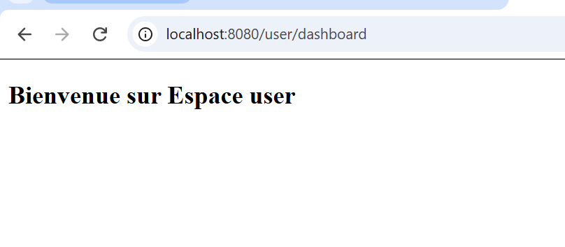
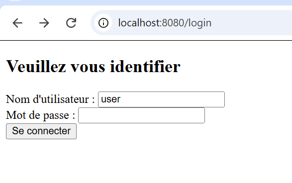

# Lab 9 – Spring Security Demo

Application web de démonstration de **Spring Security** : authentification par formulaire personnalisé, autorisation par rôles (`USER` / `ADMIN`) et pages Thymeleaf protégées.

## Technologies

| Outil | Version |
|---|---|
| Java | 21 |
| Spring Boot | 4.1.2 |
| Spring Security | (via `spring-boot-starter-security`) |
| Thymeleaf + `thymeleaf-extras-springsecurity6` | (via Spring Boot) |
| Maven | wrapper inclus (`mvnw`) |

## Fonctionnalités

- Page d'accueil publique
- Formulaire de connexion personnalisé (`/login`)
- Utilisateurs en mémoire (`InMemoryUserDetailsManager`)
- Mots de passe hachés avec **BCrypt**
- Autorisation par rôle sur `/user/**` et `/admin/**`
- Déconnexion avec redirection vers l'accueil

## Structure du projet

```
src/main
├── java/ma/esmi/security/spring_security
│   ├── SpringSecurityDemoApplication.java
│   ├── config
│   │   ├── PasswordEncoderConfig.java   # bean BCryptPasswordEncoder
│   │   ├── SecurityConfig.java          # règles d'accès, login, logout
│   │   └── UserDetailsConfig.java       # utilisateurs en mémoire
│   └── web
│       └── HomeController.java          # routes MVC
└── resources
    ├── application.properties
    └── templates
        ├── index.html
        ├── login.html
        ├── user_dashboard.html
        └── admin_dashboard.html
```

## Comptes de test

| Utilisateur | Mot de passe | Rôles |
|---|---|---|
| `user` | `1111` | `USER` |
| `admin` | `1234` | `ADMIN`, `USER` |

> Comptes destinés à la démonstration uniquement. À ne jamais utiliser en production.

## Routes et accès

| URL | Accès |
|---|---|
| `/` | Public |
| `/login` | Public |
| `/user/dashboard` | `USER` ou `ADMIN` |
| `/admin/dashboard` | `ADMIN` uniquement |
| `/logout` | Utilisateur connecté (requête `POST`) |

## Lancer le projet

```bash
git clone <url-du-depot>
cd lab9_spring-security-demo
./mvnw spring-boot:run
```

Sous Windows : `mvnw.cmd spring-boot:run`

L'application démarre sur **http://localhost:8080**.

## Captures d'écran

**Page de connexion**



**Espace utilisateur après authentification**



## Configuration de sécurité

```java
http
    .authorizeHttpRequests(auth -> auth
        .requestMatchers("/", "/error", "/css/**", "/js/**").permitAll()
        .requestMatchers("/user/**").hasAnyRole("USER", "ADMIN")
        .requestMatchers("/admin/**").hasRole("ADMIN")
        .anyRequest().authenticated()
    )
    .formLogin(form -> form
        .loginPage("/login")
        .permitAll()
    )
    .logout(logout -> logout
        .logoutSuccessUrl("/")
        .permitAll()
    );
```

## Problèmes rencontrés et solutions

| Problème | Cause | Solution |
|---|---|---|
| Erreur Thymeleaf `'!=', '%', '&&', '(' ... expected` | Syntaxe d'URL incorrecte : `@('/login')` | Utiliser `@{/login}` |
| `ERR_TOO_MANY_REDIRECTS` sur `/login` | `loginPage("/login")` configuré sans route `GET /login` : le 404 passe par `/error` (protégé), qui renvoie vers `/login` | Ajouter `@GetMapping("/login")` dans le contrôleur et autoriser `/error` |
| 404 sur `/.well-known/appspecific/com.chrome.devtools.json` | Requête automatique de Chrome DevTools | Sans effet, à ignorer (ou autoriser `/.well-known/**`) |

## Auteure

**Fatima** – Étudiante en ingénierie, EMSI Marrakech
